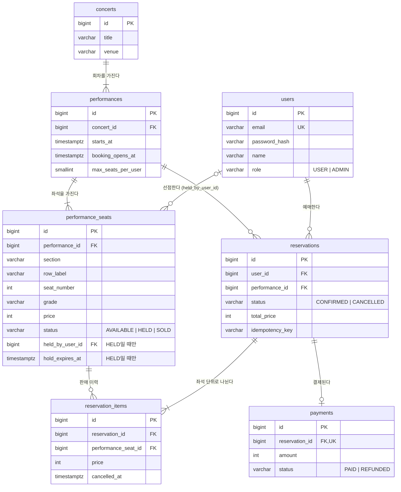

# ERD

> 스키마의 실제 정의는 `src/main/resources/db/migration/`에 있고, 이 문서는 그 설계 의도를 설명한다.
> 스키마를 바꾸면 이 문서도 같은 PR에서 함께 고친다.

## 설계 포인트

| 결정 | 이유 |
| --- | --- |
| 좌석을 **회차별**로 둔다 (`performance_seats`) | 판매 단위는 "공연장의 좌석"이 아니라 "특정 회차의 좌석"이다. 회차가 다르면 같은 자리도 별개 상품이다 |
| 선점 정보를 좌석 행에 둔다 (`held_by_user_id`, `hold_expires_at`) | MVP에서는 가장 단순한 방식으로 시작하고, 7~8주차에 Redis 방식과 비교한다 ([ADR-0004](../adr/0004-hold-in-db-first.md)) |
| `reservation_items`에 **부분 유니크 인덱스** | 취소되지 않은 판매는 좌석당 1건만 허용 → 애플리케이션이 틀려도 DB가 중복 판매를 거부한다 ([ADR-0003](../adr/0003-seat-integrity.md)) |
| `reservations`에 `(user_id, idempotency_key)` 유니크 | 결제 버튼 연타·네트워크 재시도로 같은 요청이 두 번 와도 예매는 한 건 |
| 가격을 `reservation_items.price`에 복사 | 나중에 좌석 가격이 바뀌어도 이미 판 가격은 변하지 않아야 한다 |
| 금액은 `INTEGER`(원 단위) | 원화는 소수점이 없고, 부동소수점 오차를 피한다 |
| 모든 시각은 `TIMESTAMPTZ` | 서버·DB의 시간대 설정과 무관하게 같은 시점을 가리킨다 |
| CHECK 제약으로 상태값 제한 | 잘못된 상태 문자열이 저장되는 버그를 DB 단에서 막는다 |
