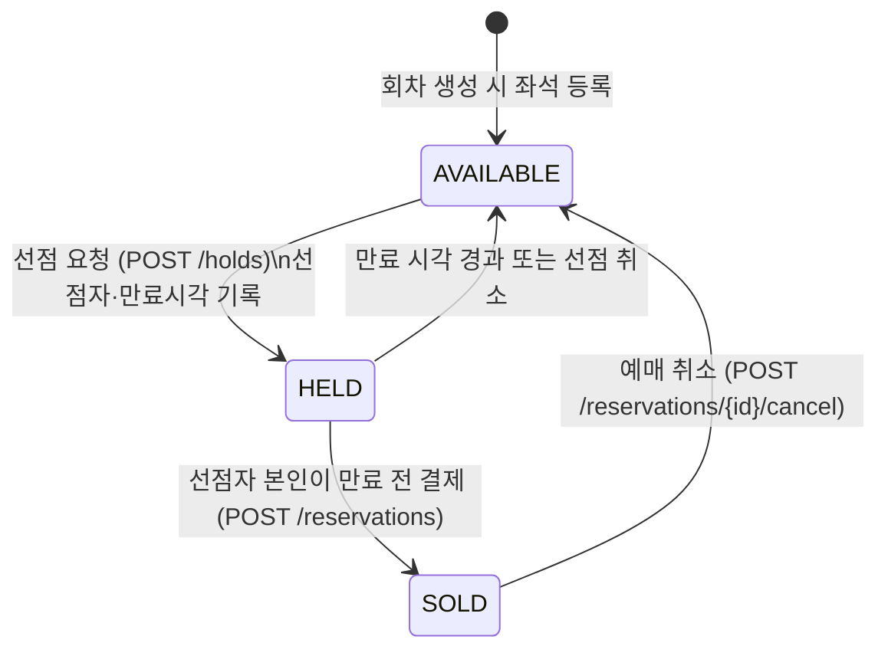

# 좌석 상태 전이

좌석 하나(`performance_seats` 한 행)는 아래 세 상태 중 하나다. **동시성 버그는 대부분 이 화살표 하나를 두 사람이 동시에 지나갈 때 생긴다.**

## 전이 규칙

| 전이 | 허용 조건 | 실패 시 응답 |
| --- | --- | --- |
| AVAILABLE → HELD | 좌석이 AVAILABLE이고, 사용자의 해당 회차 선점+보유 좌석 수가 한도 이하 | 409 `SEAT_UNAVAILABLE`, 409 `SEAT_LIMIT_EXCEEDED` |
| HELD → SOLD | 요청자가 선점자 본인이고, 만료 시각 전 | 409 `HOLD_EXPIRED`, 403 `NOT_HOLDER` |
| HELD → AVAILABLE | 만료 시각 경과 (스케줄러) 또는 선점자 본인의 취소 | - |
| SOLD → AVAILABLE | 예매자 본인의 취소, 공연 시작 전 | 409 `CANCEL_NOT_ALLOWED` |

## 이 프로젝트에서 실험할 위험 지점

**AVAILABLE → HELD 화살표**가 핵심 실험 대상이다. 두 요청이 동시에 "이 좌석 AVAILABLE이네?"를 읽고 둘 다 HELD로 바꾸면 한 좌석에 선점자가 둘이 된다(Lost Update). 3~4주차에는 이 문제를 **일부러 그대로 두고**, 6주차 부하 테스트에서 재현한 뒤, 7~8주차에 해결 방식을 비교한다.
